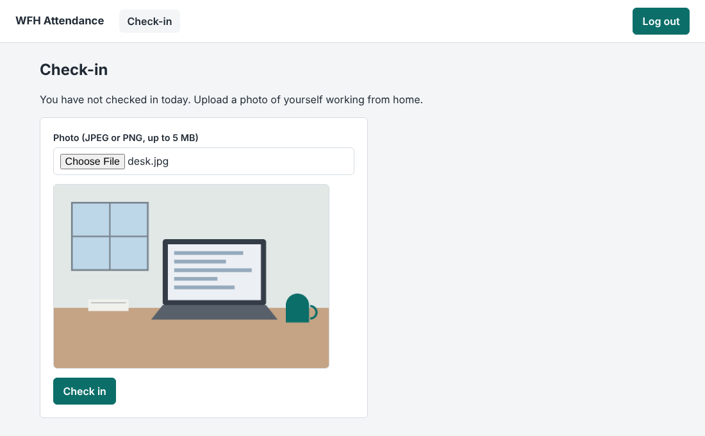
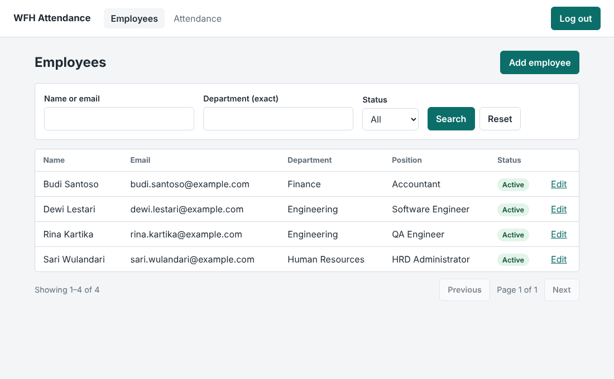
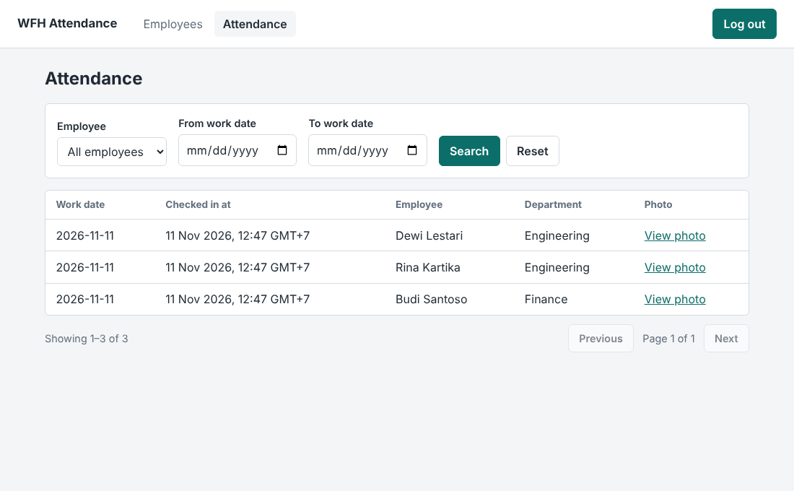
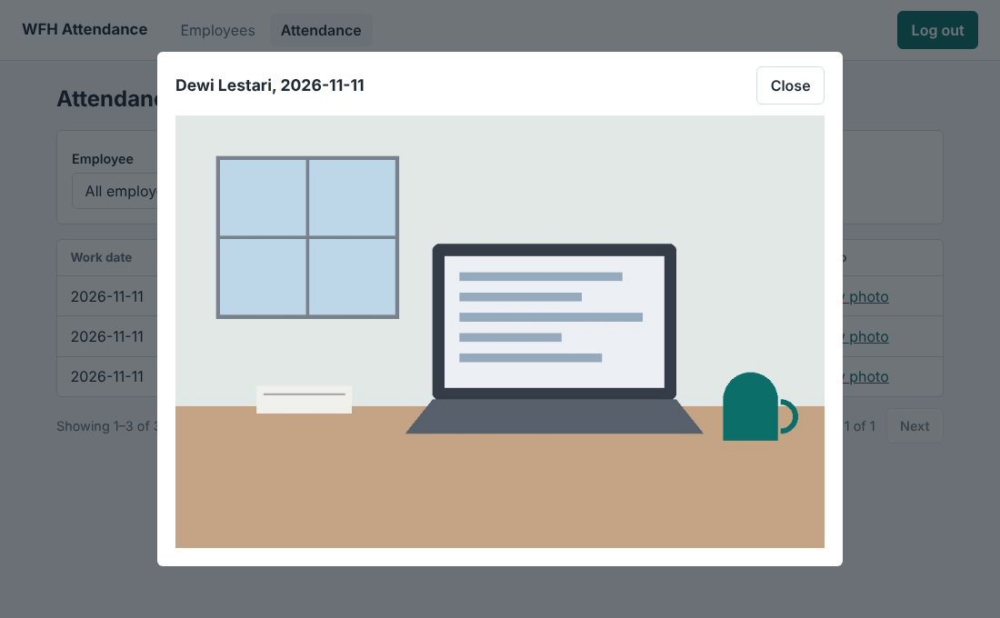

# WFH Attendance System

A web application for recording work-from-home attendance, built for the Dexa Group fullstack technical test.

- **Employees** log in and check in once per day by uploading a photo as proof that they are working from home. The server records the date and time.
- **HRD admins** manage employee master data (add, update, deactivate) and view submitted attendance, including the photos. Attendance is view-only.

**Stack:** React 19 + TypeScript (Vite) · NestJS 12 microservices over TCP · MySQL 8.4 · TypeORM

## Screenshots

| Employee check-in | HRD: employees |
|---|---|
|  |  |

| HRD: attendance | HRD: attendance photo |
|---|---|
|  |  |

## Architecture

```
React frontend (employee screens + HRD screens)
        │  HTTP + JSON, Bearer token
   API Gateway :3000     authenticates, checks roles, validates input,
        │                orchestrates calls, combines responses; owns no data
        │  NestJS TCP transport (not reachable from outside)
   ┌────┴────────┬───────────────┐
  Auth :4001   Employee :4002   Attendance :4003
  credentials  master data      records + photo files
   │             │               │
  auth_db      employee_db      attendance_db     one MySQL instance, one MySQL user
                                                  per service with access to its own database only
```

The backend is split by **data ownership**: each service owns one kind of data and is the only code that can read or write it. Login credentials are separated from employee master data mainly to limit the exposure of sensitive data, and also because the two change independently. The database server enforces the boundary too, because each service's MySQL user has privileges on its own database alone.

The full design is in [`docs/design.md`](docs/design.md): schema, the internal contract between the gateway and the services, the HTTP API, the cross-service rules (compensation when creating an employee, fail-closed deactivation, graceful degradation), and security notes.

## Running it

There are two ways. Both end with the app at <http://localhost:5173> and the seed accounts below.

### Option A: everything in Docker

**Prerequisite:** Docker with the Compose plugin.

```bash
git clone https://github.com/varrentnw/wfh-attendance-system.git
cd wfh-attendance-system
cp .env.example .env
docker compose --profile app up --build
```

This builds and starts MySQL, the three services, the gateway and the frontend, then runs the seed script once. The first build takes a few minutes. The app is ready when the `seed` container has printed the accounts it created.

Only the gateway (3000), the frontend (5173) and MySQL (3306) are published to the host. The three services have no published ports, so nothing outside the Compose network can reach them.

To stop: `docker compose --profile app down`. Add `-v` to also delete the database and the uploaded photos.

### Option B: local development

MySQL runs in Docker, and the backend and frontend run with npm, with reloading on change.

**Prerequisites:** Node.js 22.22 or newer (developed on 26), npm, and Docker with the Compose plugin.

#### 1. Configuration and database

```bash
git clone https://github.com/varrentnw/wfh-attendance-system.git
cd wfh-attendance-system
cp .env.example .env
cp frontend/.env.example frontend/.env
docker compose up -d
```

Without `--profile app`, Compose starts MySQL only. On the first start it creates the three databases and the three MySQL users (`docker/mysql/init.sql`). The values in `.env.example` work as they are for local development.

#### 2. Backend

```bash
cd backend
npm install
npm run start:all
```

`start:all` runs the gateway and the three services together. Wait until all four report `successfully started`. In development the services create their own tables on first start. To work on one service with reloading, run it by itself instead: `npx nest start gateway --watch`.

Then, in a second terminal, create the first accounts:

```bash
cd backend
npm run seed
```

#### 3. Frontend

```bash
cd frontend
npm install
npm run dev
```

Open <http://localhost:5173>.

### Seed accounts

| Username | Password | Role |
|---|---|---|
| `hrd.admin` | `Admin#2026` | HRD admin |
| `dewi.lestari` | `Dewi#2026` | Employee |
| `budi.santoso` | `Budi#2026` | Employee |
| `rina.kartika` | `Rina#2026` | Employee |

These accounts and the database passwords in `docker/mysql/init.sql` are for local development only. The seed script is safe to run more than once. It exists because HRD admin accounts cannot be created through the API: employees created there always receive the employee role.

### A short tour

1. Log in as `dewi.lestari`. Choose a JPEG or PNG photo (up to 5 MB) and check in. The page then shows the check-in time in your browser's time zone. A second check-in on the same day is refused.
2. Log out and log in as `hrd.admin`.
3. **Employees:** search and filter the list, add an employee with a login, and edit one. Setting an employee to inactive also disables their login.
4. **Attendance:** filter by employee or date range, and open a record's photo.

## Project layout

```
backend/                 NestJS monorepo
  apps/gateway/          HTTP API: guards, validation, orchestration, composition
  apps/auth/             credentials, password hashing, token signing
  apps/employee/         employee master data
  apps/attendance/       attendance records and photo files
  libs/common/           shared contracts only (message patterns, payload types, enums)
  scripts/seed.js        first HRD admin and sample employees
frontend/                React app
  src/api/               one function per endpoint, on top of a small fetch client
  src/auth/              session storage, auth context, route guards
  src/components/        reusable components (form fields, pagination, error list, photo dialog, ...)
  src/pages/             one component per screen
e2e/                     browser tests for the whole system (Playwright)
docker/mysql/init.sql    databases and per-service MySQL users
docker-compose.yml       MySQL for development, or the whole system with --profile app
docs/design.md           the design in full
wfh-attendance/          Bruno collection of API requests
```

## Assumptions

- "Today" is defined by WIB (Asia/Jakarta), the company's headquarters time zone. The server derives the work date; the browser only displays times in the viewer's own time zone.
- One check-in per employee per day. The brief does not ask for check-out.
- HRD admins are employees too, but their accounts are for administration and do not check in.
- Employees see only today's status, not their history. The brief does not ask for history.
- Employees are deactivated, never deleted, so their attendance history stays linked to a valid record.

## Testing

- **Unit tests** (`cd backend && npm test`): the two pieces of logic that need no database or framework. `toWorkDate` decides which day a check-in counts for, and is tested around WIB midnight and a year boundary. `detectImageType` identifies a photo by its first bytes, and is tested with valid, truncated and non-image content.
- **Browser tests** (`e2e/`, 26 tests): a real browser drives the frontend against the running gateway, services and MySQL. They cover login and role-based access, the whole check-in flow with its error cases (oversized file, content that is not an image, a second check-in on the same day), employee creation with validation and conflicts, search, pagination, editing, deactivation and reactivation of a login, the attendance list with its filters, and photos loaded with the token. With the system running and seeded:

  ```bash
  cd e2e
  npm install
  npx playwright install chromium
  npm test
  ```

  Each run creates its own employees (named `E2E …`), so the tests can be repeated on a database that is already in use.
- **Continuous integration:** on every push and pull request, GitHub Actions lints and builds both halves, runs the unit tests, and runs the browser tests twice: against the system started with npm, and against the Docker Compose stack (`.github/workflows/ci.yml`).
- **API:** the Bruno collection in `wfh-attendance/` holds requests used to test the backend by hand, including failure paths: validation, rejected undeclared fields (mass assignment), duplicate email and username, role checks, compensation when creating an employee (with a fault injected), and fail-closed deactivation and reactivation.
- **By hand:** two cases need a service to be stopped or broken, so they were tested manually: the attendance list while the employee service is down (records are still shown), and compensation with a fault injected.
- **Gap:** the services themselves have no unit tests. NestJS 12 packages are ESM-only; the application runs under CommonJS, but Jest could not load NestJS's testing utilities, so the generated Jest scaffolding was removed and the unit tests above run on Vitest. With more time I would add service-level tests with mocked repositories and clients.

## Known limitations

- A token issued before an account is deactivated stays valid until it expires (1 hour). The fix is for the gateway to check the account's status on every request.
- The frontend keeps the token in `localStorage`, which survives a refresh but could be read by an injected script. An `httpOnly` cookie with CSRF protection would close that gap.
- A login with an unknown username responds slightly faster than one with a wrong password, which could reveal which usernames exist.
- A crash between saving an attendance record and writing its photo would leave a record without a file.
- The attendance screen's employee filter lists the first 100 employees, and the department filter on the employee screen needs an exact match.
- Tables are created by TypeORM's `synchronize` in development. Production would use reviewed migrations, a secrets manager, and separate database users for running and migrating.

More are listed, with the reasoning, under "Future improvements" in [`docs/design.md`](docs/design.md): object storage for photos, rate limiting on login, observability across services, a departments table, and attendance filtering by department.

## Use of AI

The brief allows AI tools, and I used Claude (Anthropic) throughout.

- **Backend and design:** I used it as a tutor. I learned NestJS, TypeORM and the microservice patterns during this project, wrote the first instance of each kind of component myself, and had repeated boilerplate generated and then reviewed it.
- **Frontend:** React was new to me. With the same tutoring I wrote the login page, the route guards, the routes and the first components myself. The API client and the auth context were generated and explained to me. Because of the deadline, the remaining screens (check-in, employees, attendance), the stylesheet, the seed script, the automated tests with their CI workflow, the Docker setup, and the first draft of this README were generated by Claude. I reviewed and tested them, and those commits are marked as co-authored.

I can explain the design decisions and the code in this repository, and I am glad to walk through any part of it.
